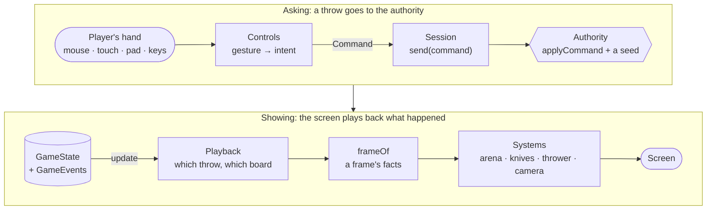
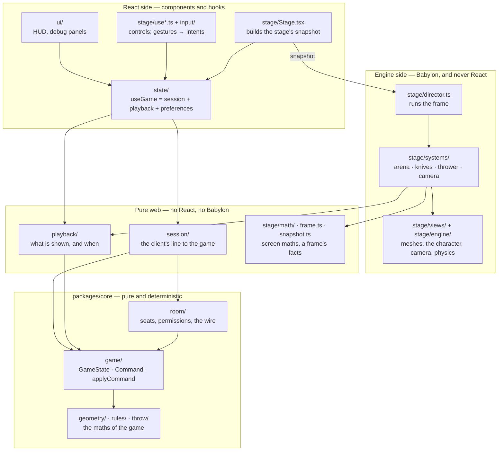
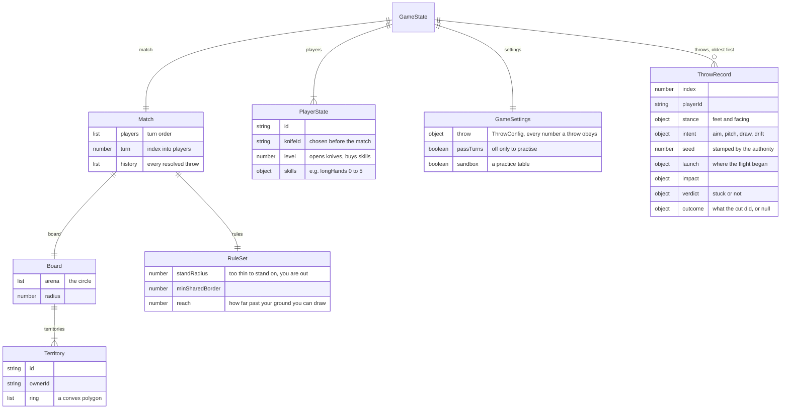
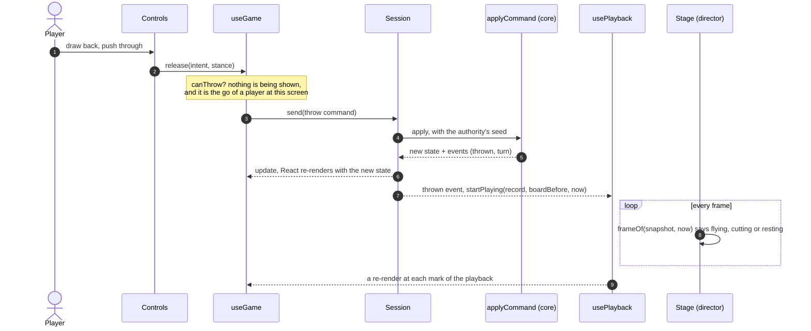
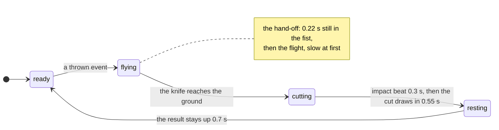
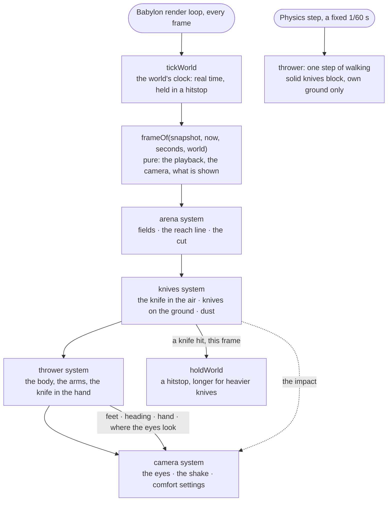
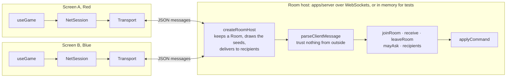
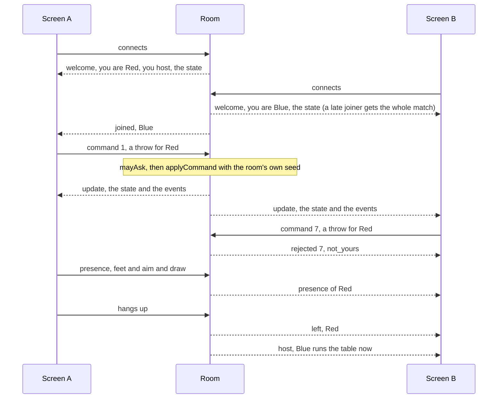

# Pocket Knives — architecture

How the code is laid out, the few rules that keep it that way, and how the
backlog — link rooms first — plugs into it. [RULES.md](RULES.md) is what the
game *is*; this is how the code is built round it.

The short version: **the game is data, changed only by a pure function from
commands; everything on screen is derived from that data and the clock.** No
classes, no inheritance, no hidden state in the rules. Behaviour is functions,
state is plain objects, and the per-frame work is a list of small systems.

The diagrams are [Mermaid](https://mermaid.js.org): GitHub draws them, and so
does any editor with a Mermaid preview.

**Contents** — [1. The loop](#1-the-loop) ·
[2. The layers](#2-the-layers) · [3. The game as data](#3-the-game-as-data) ·
[4. One throw, end to end](#4-one-throw-end-to-end) ·
[5. What the screen shows, over time](#5-what-the-screen-shows-over-time) ·
[6. A frame](#6-a-frame) · [7. Playing over a network](#7-playing-over-a-network) ·
[8. The rules](#8-the-rules) · [9. Where does new code go?](#9-where-does-new-code-go) ·
[10. How the backlog plugs in](#10-how-the-backlog-plugs-in) ·
[11. Testing](#11-testing) · [12. Module map](#12-module-map)

---

## 1. The loop

Everything the game does goes round one loop. A hand makes a gesture; the
gesture becomes a **command**; the **authority** — whoever holds the real game,
this browser or a room server — checks it and moves the game on; and the
screen **plays back** what happened, a frame at a time.



Two kinds of input take two different roads. A **throw** is a command: it goes
to the authority, which decides what came of it. **Walking and aiming** are
not: where a player stands and points *this instant* only moves the picture,
so it goes straight to the stage, never through the game. Only the stance a
throw is thrown from becomes part of its command.

---

## 2. The layers

Who may use whom. Every arrow points one way — down, towards the core — and
none points back up.



| Layer | Where | What it is | May use |
| --- | --- | --- | --- |
| **Rules and physics** | `packages/core/src/{geometry,rules,throw}` | Pure maths: the cut, the flight, sticking, the knives. | Nothing but itself. |
| **Game** | `packages/core/src/game` | The match as data (`GameState`), what can be asked of it (`Command`), what it answers (`GameEvent`), and the one function that moves it on (`applyCommand`). | The rules. |
| **Room server** | `apps/server` | The carrier: `ws` sockets plugged into the core's `createRoomHost`. Rooms by code; a size cap, a heartbeat. Decides nothing. | The room. |
| **Room** | `packages/core/src/room` | The authority at a network table, as pure functions: who sits where, who may ask for what (`mayAsk`), and what everyone is told (`joinRoom`, `receive`, `leaveRoom`). The wire protocol, and `parseClientMessage`, which checks everything a client sends. | The game. |
| **Session** | `apps/web/src/session` | The client's one line to the game: read the state, send commands, hear updates and rejections, which players this screen plays for, others' presence. A local authority (`createLocalSession`) or a room over a `Transport` (`connectNetSession`). | The game, the room's protocol. |
| **Playback** | `apps/web/src/playback` | Pure: a throw event becomes a playback, and the playback and the clock decide which throw (`shownThrow`) and which board (`shownBoard`) are on screen. | The game's types. |
| **State hooks** | `apps/web/src/state` | React glue: `useGame` reads the session, sends commands, and composes `usePlayback` (the playback's lifecycle) and `usePreferences` (this device's choices). Decides nothing. | Session, playback. |
| **Stage** | `apps/web/src/stage` | `frameOf` works out a frame's facts; systems pose the views. `math/` is pure and tested; `views/`, `systems/` and `engine/` are the only code that touches Babylon. | Playback, the snapshot. |
| **Controls** | `apps/web/src/input`, `stage/use*.ts` | Pointer, touch, pad and keys turned into intents and walking. | State hooks. |
| **UI** | `apps/web/src/ui` | The HUD and debug panels, in React. | State hooks. |

The arrows are not a convention but a test: `apps/web/src/architecture.test.ts`
fails if the core reaches for React, Babylon, the browser, a clock or
randomness; if a pure web folder imports React or Babylon; if anything but the
stage's views, systems and engine touches Babylon; or if the engine side
imports React. The engine side takes what it needs — the snapshot, the hand,
the stance as a `Live<T>` box — and never reaches back.

---

## 3. The game as data

The whole game is one plain, serialisable value. Nothing in it is a class or
points at anything on screen, so it can be sent over a network, stored,
compared, and replayed.



It changes in exactly one way:

```text
applyCommand(state, command, { seed }) → { ok: true, state, events } | { ok: false, reason }
```

- **Commands** are everything anyone can ask for: `throw`, `chooseKnife`,
  `newMatch`, and at a practice table `configure`, `giveTurn` and `setSkill`.
  A throw carries the stance and the hand's intent — never an outcome, never a
  seed.
- **The stamp** is the authority's part: the seed a throw's wobble is drawn
  from. Whoever runs the game draws it, so no player chooses their own luck.
- **Events** say what happened, for everyone watching: `thrown` (with the board
  the knife landed on), `turn`, `eliminated`, `won`, `knifeChosen`,
  `matchStarted`, `configured`, `skillSet`.
- **Rejections** say why not, and change nothing: `not_your_turn`,
  `off_your_ground`, `not_a_throw`, `knife_locked`, `match_under_way`,
  `match_over`, `sandbox_only`, `unknown_player`, `unknown_knife` — and at a
  network table also `not_seated`, `not_yours`, `host_only`.
- **Rules a player bends** go through `rulesFor(state, playerId)`: Long hands
  lengthens only its owner's reach.

A throw's flight is not stored, only where it began: the arc is closed-form,
so any client redraws it exactly from `launch` and the flight tuning. That
keeps a record small enough to send, and a whole match replayable from its
first state and its stamped commands.

---

## 4. One throw, end to end

From the hand letting go to the cut drawing itself.



A few things that are easy to miss:

- **The game is decided at step 4**, the instant the hand lets go: flight,
  stick and cut are pure functions, so the result exists before the first
  frame of the flight is drawn. Everything after is a replay of a known result.
- **`release` takes the stance as an argument**, not from React's state: the
  player walks every frame, and a whole push can land inside one, so React's
  copy would be where they were a moment ago.
- **The stage never asks React for anything.** `Stage.tsx` writes a fresh
  `StageSnapshot` after each render; the director reads it once a frame.

---

## 5. What the screen shows, over time

A thrown knife starts a **playback**: a few numbers — when it started, how fast
it plays, when it lands — and the clock. Which part of the throw is on screen
is a pure function of those (`shownThrow`), so the HUD and the scene ask the
same question and cannot disagree.



- **Flying.** The arm swings through for 0.22 s with the knife still in the
  fist, then the knife flies — at an eighth of real time for 0.3 s, ramping up
  over 0.6 s to the cruising pace (0.55 of real time by default, the "slow"
  setting).
- **Cutting.** The camera stays at eye level for the impact beat, then lifts
  over the circle while the cut draws itself.
- **The board lags the game on purpose** (`shownBoard`): until the cut has
  drawn, the screen shows the board the knife landed on. Land changing hands
  is the payoff and arrives after the line that caused it.
- **No timer decides anything.** One timer re-renders the HUD at the next mark
  (`nextChangeAt`); the answer itself comes from the clock. Drop a frame,
  reload, or join a room mid-throw, and the next frame is simply right.

---

## 6. A frame

The director runs one pass per frame: work the facts out once, then let each
system pose the views it owns, in order, handing on what the next needs.



- **A system is two functions,** `update(frame, input)` and `dispose()` — no
  base class. Each owns its views; the director is the list of them.
- **Two clocks.** Real time paces the playback, which is on a schedule. The
  world's clock (`worldClock.ts`) stands still for a few frames when a knife
  hits — 20 to 90 ms by its weight — and everything that happens on impact
  (dust, the quiver, the arm's follow-through, the shake) runs on it, so the
  whole world freezes together and carries on together.
- **Walking runs in the physics' fixed steps,** not per frame: a variable step
  makes a body move and collide a little differently at 60 frames a second than
  at 144. Where the feet end up is written back to the stance a throw is
  thrown from.
- **The hand lags the view.** The view follows the mouse exactly; the hand
  trails it on a spring, so a quick turn has weight without feeling floaty.

---

## 7. Playing over a network

A **room** is the authority at a network table. Its whole behaviour is pure
functions in the core — who sits where, who may ask for what, what everyone is
told — so it is tested without a network, and a server is only a thin shell
that keeps a `Room`, feeds it what arrives, and delivers what it answers.



What the room and two screens say to each other:



- **Seats** go in turn order; anyone after the last seat watches. The first to
  join hosts, and the table passes on when the host leaves.
- **`mayAsk`** comes before the game is asked: a player acts only for their
  own seat (`not_yours`), a watcher for nobody (`not_seated`), and only the
  host starts a match, tunes the sandbox or hands the turn (`host_only`).
- **Everything a client sends is checked** by `parseClientMessage` and rebuilt
  from only the fields it checked — an extra field, a smuggled seed, a `NaN`,
  a tuning in the wrong shape, all turned away before the game sees them.
- **Presence** is relayed under the sender's own seat, never a player id they
  claim, ten times a second (`usePublishPresence`). It is lossy on purpose:
  a missed one is replaced by the next.
- **The session hides all of it.** `useGame` talks to a `Session` — state,
  `send`, `subscribe`, `onRejected`, `controls`, `isHost`, `presence` — and
  cannot tell a local game from a room. Every answer comes back one way: the
  update through `subscribe`, the refusal through `onRejected`.

**The carrier is the only part that is not ours.** `createRoomHost` (core)
keeps a room and puts messages on and off the wire, once, for every carrier.
Round it:

- `apps/server` is a plain [`ws`](https://github.com/websockets/ws) server:
  a socket opened on `/rooms/<code>` joins that room, its text goes to the
  host, the host's replies go back down the sockets they are for. Rooms are
  made by the first to open the link and forgotten when the last one leaves.
  It adds only what a public socket needs — a size cap on messages, the usual
  ping/pong heartbeat, a cap on rooms — and decides nothing. No game framework:
  the state, the protocol and the rules were already written and tested, so a
  framework's own state sync would have been a second copy of them.
- `openWebSocketTransport` (web) is the same `Transport` the session already
  speaks, over the browser's own `WebSocket`.
- `createLoopbackRoom` (web) is the same host with a queue where the socket
  would be; the tests play two screens against each other with it.

**Joining is an address.** `?room=<code>` makes the page join that room
(`useTable`); without it the page is the practice table in this browser. "Play
with friends" makes a fresh code and goes there; the room bar copies the link
to send. The room server is looked for beside the page on port 8787 — what a
phone on the same Wi-Fi needs — unless `VITE_ROOM_SERVER` names another.

---

## 8. The rules

1. **The core is pure and deterministic.** No `Math.random`, no clocks, no
   DOM, no engine. Randomness arrives as a seed; time arrives as an argument.
   Same inputs, same outputs, on any machine. *Checked by a test.*
2. **State is plain data.** `GameState` is serialisable: no methods, no class
   instances, no references to anything on screen. It can be sent, stored,
   diffed and replayed. *A test sends a played game through JSON.*
3. **Only `applyCommand` changes the game.** Everything a player (or a bot, or
   a host) can do is a `Command`. The authority checks it and either applies
   it or turns it down with a reason; the state never changes any other way.
4. **The authority owns the dice.** A throw command carries the stance and the
   hand's intent, never an outcome and never a seed. Whoever is the authority
   stamps the seed (`Stamp`), so no player chooses their own luck, and a throw
   can be verified from its record.
5. **Events say what happened; state says where things stand.** A `thrown`
   event carries the board the knife landed on, so any client — even one that
   only ever saw the state after — can show the cut arriving.
6. **The screen is derived, never stored.** What is on screen is a function of
   the state, the last events and the clock (`shownThrow`, `shownBoard`,
   `frameOf`). No timer decides anything.
7. **Per frame, systems over data.** The director builds one `Frame` of facts
   and runs the systems in order; each owns its views and hands on what the
   next needs. Two clocks run through a frame — real time and the world's —
   and walking runs in the physics' fixed steps.
8. **Cosmetic physics never decides anything.** Havok bounces failed knives
   and keeps the walker off standing ones; who owns land is decided only by
   the core.
9. **No classes anywhere.** Data is plain, behaviour is functions, and the
   few long-lived things (a view, a session, a system) are closures.
   *Checked by a test.*
10. **Layers point one way.** The core knows nothing of the web; the web's pure
    parts know nothing of React or Babylon; the engine side never reaches back
    into React. *Checked by a test.*
11. **One answer to one question.** Which throw is on screen (`shownThrow`),
    whether this screen may throw now (`canThrow`), how a refusal is heard
    (`onRejected`): each is worked out in one place and read everywhere else,
    so no two parts of the game can disagree.

---

## 9. Where does new code go?

| It… | Put it in |
| --- | --- |
| decides who owns land, whether a knife sticks, whose turn it is | `packages/core/src/rules` or `throw` — with a test |
| is something a player can ask for | a `Command` in `core/game/commands.ts`, handled in `applyCommand` |
| is something everyone should be told about | a `GameEvent` |
| bends a rule for one player (a skill) | `PlayerState.skills`, read through `rulesFor` |
| is something a player may or may not ask for at a network table | `mayAsk` in `core/room/room.ts` |
| arrives from another machine | a `ClientMessage`, checked in `parseClientMessage` before anything else sees it |
| is a number that shapes a throw | `ThrowConfig` (`core/throw/config.ts`), so it can be tuned and sent |
| is about pacing what is shown | `apps/web/src/playback` — pure, from events and the clock |
| is a new thing on screen | a view in `stage/views`, posed by a system in `stage/systems` |
| is maths for the screen | `stage/math` — pure, with a test |
| is this device's preference | `usePreferences`, remembered with `useRememberedFlag` / `useRememberedChoice` |
| carries messages to a room (WebRTC, another socket) | a `Transport` in `apps/web/src/session`; on the server, connections plugged into `createRoomHost` |

---

## 10. How the backlog plugs in

- **Link rooms.** Playable (§7): `pnpm rooms` beside the web app, and a link.
  What is left is what makes it feel like a room: the other players drawn
  from their presence, taking your seat back after a dropped connection, and
  the match flow round it (a lobby, a rematch).
- **Party mode.** Hotseat is a local session with every player on one device —
  today's sandbox with the practice settings off. Phones as controllers are a
  network session where each phone sends one player's commands.
- **Bots.** A bot is a function from `GameState` to a `Command`: choose a
  stance and an intent, send it. It plays by the same physics because it goes
  through the same `applyCommand`.
- **Throw replay** and **Clip share.** A `ThrowRecord` holds the launch, the
  seed and the result; the flight is a closed-form arc the client redraws. A
  whole match replays from the first state and its stamped commands.
- **Daily board.** A `createGame` with a fixed seed and fixed ground, the same
  for everyone; scores compare because the core is deterministic.
- **Match flow.** Elimination and the winner are already events (`eliminated`,
  `won`); a rematch is the `newMatch` command.
- **Grounds, Wind.** Settings in `GameSettings.throw` — soil and air are
  numbers the flight already reads.
- **Progression** (knives by level, Long hands). Per-player data in
  `PlayerState` (`level`, `knifeId`, `skills`). A skill that bends a rule does
  it through `rulesFor(state, playerId)`; until experience is kept, the
  sandbox sets it with the `setSkill` command.

---

## 11. Testing

- **The core is tested as functions:** rules, flight, sticking, `applyCommand`
  (a replay test proves determinism), and the room — seating, permissions,
  every malformed message turned away, a played game surviving JSON.
- **The web's pure parts** — playback, the frame, poses, strides, the camera,
  the world clock — are tested the same way, with no browser.
- **The room server is tested over real sockets** (`apps/server`): two
  players in a room, a throw seen by both, rubbish survived, rooms kept apart
  and forgotten when empty.
- **Two screens play each other** through the loopback room
  (`session/netSession.test.ts`): a throw seen on the other screen, a
  rejection heard, a late joiner given the match, presence, the host handing on.
- **The architecture is tested** (`architecture.test.ts`): purity, layers and
  no classes, each rule seen to fail with a violation planted.
- **The rigged character** is tested headless on Babylon's `NullEngine`.
- **The scene is checked by looking:** `pnpm --filter @pocketknives/web shots`
  screenshots every debug camera (`--throw`, `--walk`, `--draw` for moments),
  and `window.pocketknives` gives a console or a script the session and a real
  throw.

---

## 12. Module map

```text
packages/core/src/                 pure, deterministic; no React, Babylon or browser
  geometry/                        rings, splits, clusters, raycasts — polygon maths
  rules/                           the board, the cut, orphaned ground, standing, turns
  throw/                           the knife: config, swing → launch, flight, sticking
  game/                            GameState, Command, GameEvent, applyCommand, stance
  room/                            the network table: room, protocol, message checks, the host that keeps one

apps/server/src/                   the room server: carries messages, decides nothing
  server.ts                        WebSockets (ws) on /rooms/<code>, heartbeat, limits
  rooms.ts                         rooms by code: made on first join, forgotten when empty
  main.ts                          `pnpm rooms` — listens on PORT, 8787 by default

apps/web/src/
  session/                         the client's line to the game
    session.ts                     Session; the local authority
    netSession.ts                  a room across a Transport
    transport.ts                   what carries messages
    webSocketTransport.ts          …over a WebSocket, to apps/server
    roomLink.ts                    room codes, the join link, where the server is
    loopback.ts                    a room in memory, for tests
  playback/                        pure: attempts, slow motion, which throw and board are shown
  state/                           React hooks: useTable, useGame, usePlayback, usePreferences, useComfort
  input/                           gestures → intents: strokes, look, turning, walking, devices
  ui/                              the HUD, the knife picker, tuning and comfort panels
  audio/                           the sound of a knife hitting the ground
  stage/
    Stage.tsx                      the canvas; builds the snapshot; mounts the controls
    use*.ts                        controls (pointer, touch, pad) and presence publishing
    snapshot.ts                    the seam: everything the stage reads, and nothing else
    frame.ts                       frameOf — a frame's facts, worked out once
    director.ts                    runs the frame: clocks, then the systems in order
    systems/                       arena, knives, thrower, camera — update and dispose
    views/                         Babylon: the arena, knives, the character, the camera rig
    engine/                        the engine, the scene, Havok physics
    math/                          pure screen maths: poses, IK, springs, shake, the reach line
  architecture.test.ts             the rules above, checked
```
